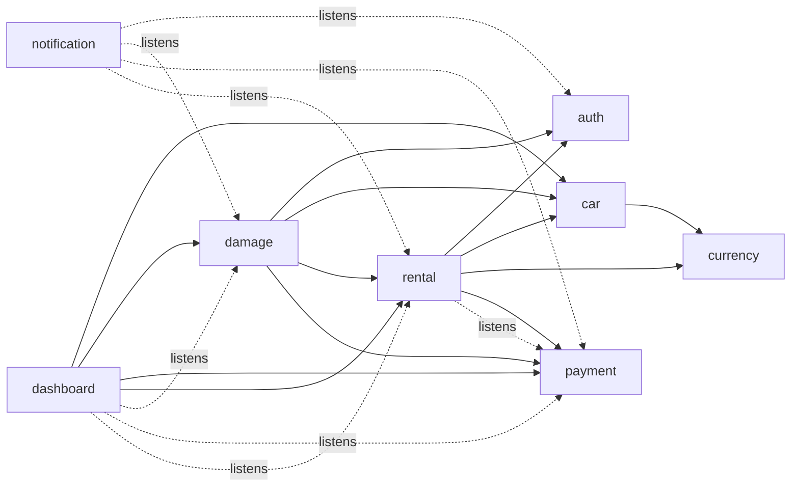

# Car Rental API

A car rental backend: catalogue and availability search, rental requests with a payment step, damage and late-return handling, an admin dashboard and e-mail notifications. It is a portfolio project, built to show how a modular Spring service is structured and verified; it is not a deployed product. Stripe runs in test mode only. Commits up to `349b272` are the original learning build; the 2026-11 refactor follows.

The web client lives in [TheOdrig/car-rental-web](https://github.com/TheOdrig/car-rental-web).

## Stack

| Area | Choice |
| --- | --- |
| Language / framework | Java 21, Spring Boot 4.1.2 ([`pom.xml`](pom.xml)) |
| Modularity | Spring Modulith 2.1.2 |
| Database | PostgreSQL 18, Flyway migrations, Hibernate with `ddl-auto=validate` |
| Security | Spring Security OAuth2 resource server (JWT), Bucket4j 8.10.1 rate limiting |
| Payments | Stripe Java SDK 26.3.0 (test mode) |
| API docs / metrics | springdoc-openapi 3.1.1, Actuator with Micrometer Prometheus |
| Tests | JUnit 6, Testcontainers (PostgreSQL), JaCoCo |

## Architecture

A modular monolith with nine Spring Modulith modules under [`src/main/java/com/akif`](src/main/java/com/akif). Each module's `package-info.java` declares which other modules it may use, and only through their `api` packages; `shared` is an open module. [`ModularityTests`](src/test/java/com/akif/ModularityTests.java) asserts the exact module set, runs `modules.verify()` and writes the Modulith documentation. The graph below is the dependency set that run reports.



Every module also depends on `shared` (security, error handling, configuration), which is left out of the diagram. Solid arrows are API calls, dotted arrows are application events.

## Engineering notes

- **Booking integrity.** Overlapping rentals of one car are prevented by the database, not by a check-then-insert: a `btree_gist` exclusion constraint over car and date range ([`V4__rental_overlap_exclusion.sql`](src/main/resources/db/migration/V4__rental_overlap_exclusion.sql)). It is exercised in [`RentalOverlapConstraintTest`](src/test/java/com/akif/rental/integration/RentalOverlapConstraintTest.java), and competing requests in [`DuplicateBookingAndConfirmationE2ETest`](src/test/java/com/akif/e2e/edgecases/DuplicateBookingAndConfirmationE2ETest.java).
- **Authentication.** Stateless JWT via the Spring Security resource server ([`JwtConfig`](src/main/java/com/akif/shared/security/JwtConfig.java)). Access JWTs carry `token_use=access` ([`TokenUse`](src/main/java/com/akif/shared/security/TokenUse.java)) and the resource server rejects any JWT without it. Refresh tokens are not JWTs: they are opaque, stored only as hashes and rotate on every use; presenting an already-rotated token outside a short grace window revokes its whole token family ([`RefreshTokenService`](src/main/java/com/akif/auth/internal/service/RefreshTokenService.java), [`RefreshTokenIntegrationTest`](src/test/java/com/akif/auth/integration/RefreshTokenIntegrationTest.java)).
- **Rate limiting.** Per-category token buckets for login, register, refresh, password reset, OAuth2 callback, rental requests and payment intents, configured under `security.rate-limit.*` ([`RateLimitFilter`](src/main/java/com/akif/shared/security/ratelimit/RateLimitFilter.java), [`RateLimitIntegrationTest`](src/test/java/com/akif/shared/security/ratelimit/RateLimitIntegrationTest.java)). Login and forgot-password also have per-username buckets. Forwarded headers and the client IP header are trusted only from remotes inside the configured `TRUSTED_PROXY_CIDRS`.
- **Payments.** Stripe PaymentIntents with manual capture ([`StripePaymentGateway`](src/main/java/com/akif/payment/internal/service/gateway/impl/StripePaymentGateway.java)). Idempotency keys are deterministic and derived from the business operation (rental, penalty, damage charge or refund), so a retry inside Stripe's idempotency window (about 24 hours) cannot create a second charge, and each key and PaymentIntent carries a per-installation identity so a database reset or a second deployment cannot collide on Stripe ([`IdempotencyKeyGenerator`](src/main/java/com/akif/payment/internal/service/gateway/IdempotencyKeyGenerator.java)). Webhooks are signature-verified and replay-safe ([`StripeWebhookController`](src/main/java/com/akif/payment/web/StripeWebhookController.java), [`StripeWebhookSignedIntegrationTest`](src/test/java/com/akif/payment/integration/StripeWebhookSignedIntegrationTest.java)). The `dev` and `test` profiles use a [stub gateway](src/main/java/com/akif/payment/internal/service/gateway/impl/StubPaymentGateway.java); only `prod` talks to Stripe.
- **Event publication registry.** Cross-module events go through Spring Modulith's JPA-backed registry, with `@ApplicationModuleListener` as the trigger and outstanding events republished on restart ([`application.properties`](src/main/resources/application.properties), [`V6__event_publication.sql`](src/main/resources/db/migration/V6__event_publication.sql), [`EventPublicationRegistryIntegrationTest`](src/test/java/com/akif/notification/integration/EventPublicationRegistryIntegrationTest.java)).
- **Errors.** Failures are RFC 9457 problem details with stable error codes ([`GlobalExceptionHandler`](src/main/java/com/akif/shared/handler/GlobalExceptionHandler.java), [`ProblemDetailContractTest`](src/test/java/com/akif/contract/ProblemDetailContractTest.java)).
- **API contract.** The committed [`openapi/openapi.json`](openapi/openapi.json) and the [endpoint inventory](openapi/endpoint-inventory.txt) (method, path, required role) are compared with what the application generates, so drift fails the build ([`OpenApiContractTest`](src/test/java/com/akif/contract/OpenApiContractTest.java), [`EndpointInventoryTest`](src/test/java/com/akif/contract/EndpointInventoryTest.java)). Regenerate with [`scripts/update-contract.sh`](scripts/update-contract.sh).
- **Operations.** Actuator health (liveness and readiness probes), info and Prometheus metrics are served on a separate management port, 8081, not on the API port ([`ManagementEndpointsTest`](src/test/java/com/akif/contract/ManagementEndpointsTest.java)).
- **Time.** A single UTC `Clock` bean is injected where time matters, and the JVM, Hibernate and the database session are set to UTC ([`ClockConfig`](src/main/java/com/akif/shared/config/ClockConfig.java), [`ClockConfigTest`](src/test/java/com/akif/shared/config/ClockConfigTest.java)).

## Quick start

Docker Compose, one command, no `.env` needed:

```bash
docker compose up --build
```

This starts PostgreSQL 18 and the API with the `dev` profile ([`docker-compose.yml`](docker-compose.yml)). Flyway applies the migrations and loads sample data (users, cars, rentals, payments, damages) from `src/main/resources/db/seed`. Payments use the stub gateway, e-mail sending is off, and no Stripe or OAuth credentials are needed. The seed creates an `admin` account (credentials in [`R__seed_01_users.sql`](src/main/resources/db/seed/R__seed_01_users.sql)); it exists only with the `dev` profile, never in `prod` or `test`. Uploaded files (avatars, damage photos) go to the `uploads` volume.

| What | Where |
| --- | --- |
| API | http://localhost:8082/api/v1, for example `GET /api/v1/cars` |
| Swagger UI (dev only) | http://localhost:8082/swagger-ui/index.html |
| Health, metrics | http://localhost:8081/actuator/health and `/actuator/prometheus` |

Remove everything, data included, with `docker compose down -v`.

To run the API from Maven instead, start only the database (published on port 5433) and use Java 21:

```bash
docker compose up -d db
DATABASE_URL=jdbc:postgresql://localhost:5433/car_rental SPRING_PROFILES_ACTIVE=dev ./mvnw spring-boot:run
```

## Verify

```bash
bash scripts/verify.sh
```

`scripts/verify.sh` is the full gate. It checks that no AI or planning files are tracked ([`scripts/check-no-ai-files.sh`](scripts/check-no-ai-files.sh)), runs `scripts/verify.local.sh` (or `.ps1`) when a contributor has added one, requires the OpenAPI artifacts to exist, then runs `./mvnw -B verify`: the full suite of about 1,700 tests against a real PostgreSQL 18 started by Testcontainers (Docker must be running), followed by JaCoCo gates of 80% line and 63% branch coverage overall plus line floors for the `payment`, `rental` and `auth` modules. It takes several minutes. On Windows use `scripts/verify.ps1`.

[`scripts/setup-hooks.sh`](scripts/setup-hooks.sh) installs a pre-push hook. When the pushed range touches `src/`, `pom.xml`, `scripts/`, `Dockerfile`, `docker-compose.yml`, `.mvn/` or `openapi/`, it runs the full gate (`scripts/verify.sh`); otherwise only the fast checks (the AI-file guard, artifact presence and `LogSafetyTest`, `ModularityTests`, `OpenApiContractTest`, `EndpointInventoryTest`, about a minute). [`scripts/nightly.sh`](scripts/nightly.sh) (or `.ps1`) runs the full gate and, with `NIGHTLY_DEPENDENCY_CHECK=1`, the dependency scan. There is no hosted CI; the local gate is the check.

## API documentation

[`openapi/openapi.json`](openapi/openapi.json) is the versioned contract for the `/api/v1` surface. Swagger UI and `/v3/api-docs` are enabled in `dev` and disabled in `prod`.

## Configuration

Profiles are `dev`, `test` and `prod`. [`.env.example`](.env.example) lists every variable. `prod` has no defaults for its secrets and endpoints, so these must be set: `DATABASE_URL`, `DB_USERNAME`, `DB_PASSWORD`, `JWT_SECRET`, `CORS_ORIGINS`, `TRUST_FORWARDED_HEADERS`, `TRUSTED_PROXY_HOPS`, `TRUSTED_PROXY_CIDRS` (when forwarded headers or `TRUSTED_CLIENT_IP_HEADER` are trusted), `APP_BASE_URL`, `OAUTH2_STATE_SECRET`, `GOOGLE_CLIENT_ID`, `GOOGLE_CLIENT_SECRET`, `GITHUB_CLIENT_ID`, `GITHUB_CLIENT_SECRET`, `EXCHANGE_RATE_API_KEY`, `STRIPE_API_KEY`, `STRIPE_WEBHOOK_SECRET`, `STRIPE_METADATA_ENVIRONMENT`, `EMAIL_FROM`, `SENDGRID_API_KEY` and the `R2_*` storage settings. `prod` accepts only Stripe test-mode keys; a live key fails startup ([`ProdConfigurationValidator`](src/main/java/com/akif/shared/config/ProdConfigurationValidator.java)).

## License

[MIT](LICENSE)
