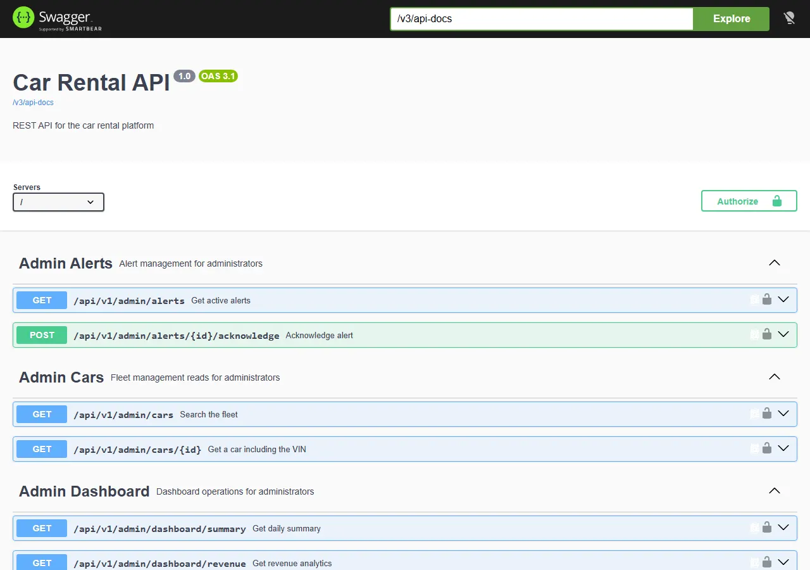
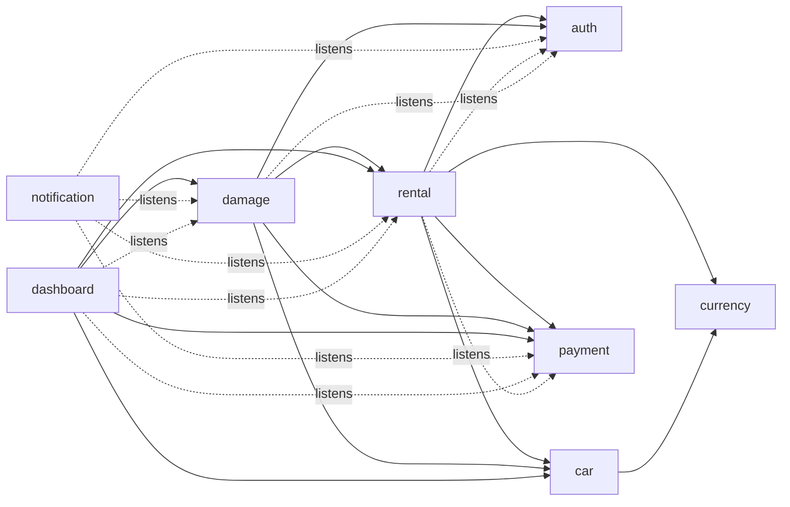

# Car Rental API

A Spring Boot backend for a car rental service: catalogue and availability search, rental requests with a payment step, damage and late-return handling, an admin dashboard and e-mail notifications.

This is a portfolio project, built to show how a modular Spring service is structured and verified. It is not deployed anywhere, and Stripe runs in test mode only.



The web client is [TheOdrig/car-rental-web](https://github.com/TheOdrig/car-rental-web).

## Quick start

You need Docker. One command, no `.env` file:

```bash
docker compose up --build
```

This starts PostgreSQL and the API with the `dev` profile, applies the Flyway migrations and loads seed data (users, cars, rentals, payments, damages). Payments use a stub gateway, and no Stripe or OAuth credentials are needed.

- API: http://localhost:8082/api/v1, for example `GET /api/v1/cars`
- Swagger UI (disabled in `prod`): http://localhost:8082/swagger-ui/index.html
- Health: http://localhost:8081/actuator/health · Prometheus metrics: http://localhost:8081/actuator/prometheus

The seed has an `admin` account in [`R__seed_01_users.sql`](src/main/resources/db/seed/R__seed_01_users.sql); it exists only with the `dev` profile. Remove everything, data included, with `docker compose down -v`.

## Architecture

A modular monolith with nine Spring Modulith modules under [`src/main/java/com/akif`](src/main/java/com/akif). Domain modules declare their allowed dependencies. Modules expose named API packages for cross-module use, and `shared` is an open module. [`ModularityTests`](src/test/java/com/akif/ModularityTests.java) verifies the structure.

**Selected module dependencies and event listeners**



Solid arrows show allowed dependencies, and dotted arrows point from listeners to event sources.

## Highlights

| Topic | What it does | Proof |
| --- | --- | --- |
| Booking integrity | The database prevents overlapping rentals with a `btree_gist` exclusion constraint | [`V4__rental_overlap_exclusion.sql`](src/main/resources/db/migration/V4__rental_overlap_exclusion.sql), [`RentalOverlapConstraintTest`](src/test/java/com/akif/rental/integration/RentalOverlapConstraintTest.java) |
| Authentication | Access tokens are JWTs. Refresh tokens are opaque, stored as hashes and rotated on successful use. Reuse after a short grace period revokes the token family. | [`RefreshTokenService`](src/main/java/com/akif/auth/internal/service/RefreshTokenService.java), [`RefreshTokenIntegrationTest`](src/test/java/com/akif/auth/integration/RefreshTokenIntegrationTest.java) |
| Rate limiting | Per-category token buckets for login, register, refresh, password reset, rentals and payments | [`RateLimitFilter`](src/main/java/com/akif/shared/security/ratelimit/RateLimitFilter.java), [`RateLimitIntegrationTest`](src/test/java/com/akif/shared/security/ratelimit/RateLimitIntegrationTest.java) |
| Payments | Stripe PaymentIntents with manual capture, deterministic idempotency keys, signature-verified webhooks | [`IdempotencyKeyGenerator`](src/main/java/com/akif/payment/internal/service/gateway/IdempotencyKeyGenerator.java), [`StripeWebhookSignedIntegrationTest`](src/test/java/com/akif/payment/integration/StripeWebhookSignedIntegrationTest.java) |
| Events | Spring Modulith records deliveries to module listeners in PostgreSQL and retries outstanding publications on restart. | [`EventPublicationRegistryIntegrationTest`](src/test/java/com/akif/notification/integration/EventPublicationRegistryIntegrationTest.java) |
| Errors | RFC 9457 problem details with stable error codes | [`ProblemDetailContractTest`](src/test/java/com/akif/contract/ProblemDetailContractTest.java) |
| API contract | The committed OpenAPI file and endpoint inventory are compared with the running app, so drift fails the build | [`OpenApiContractTest`](src/test/java/com/akif/contract/OpenApiContractTest.java), [`openapi/openapi.json`](openapi/openapi.json) |

## Stack

Java 21, Spring Boot, Spring Modulith, PostgreSQL with Flyway, Spring Security (JWT resource server), Bucket4j, Stripe Java SDK (test mode), springdoc-openapi, Micrometer with Prometheus, JUnit and Testcontainers. Versions are in [`pom.xml`](pom.xml).

## Verify

```bash
bash scripts/verify.sh
```

On Windows use `scripts/verify.ps1`. It checks that no local-only or planning files are tracked, then runs the full test suite against a real PostgreSQL started by Testcontainers (Docker must be running) with JaCoCo coverage gates. It takes several minutes. There is no hosted CI; this local gate is the check.

Configuration variables are listed in [`.env.example`](.env.example). `prod` has no defaults for its secrets and accepts only Stripe test-mode keys.

## Documentation

See the [documentation index](docs/README.md) and [security reporting policy](SECURITY.md).

## License

[MIT](LICENSE)
