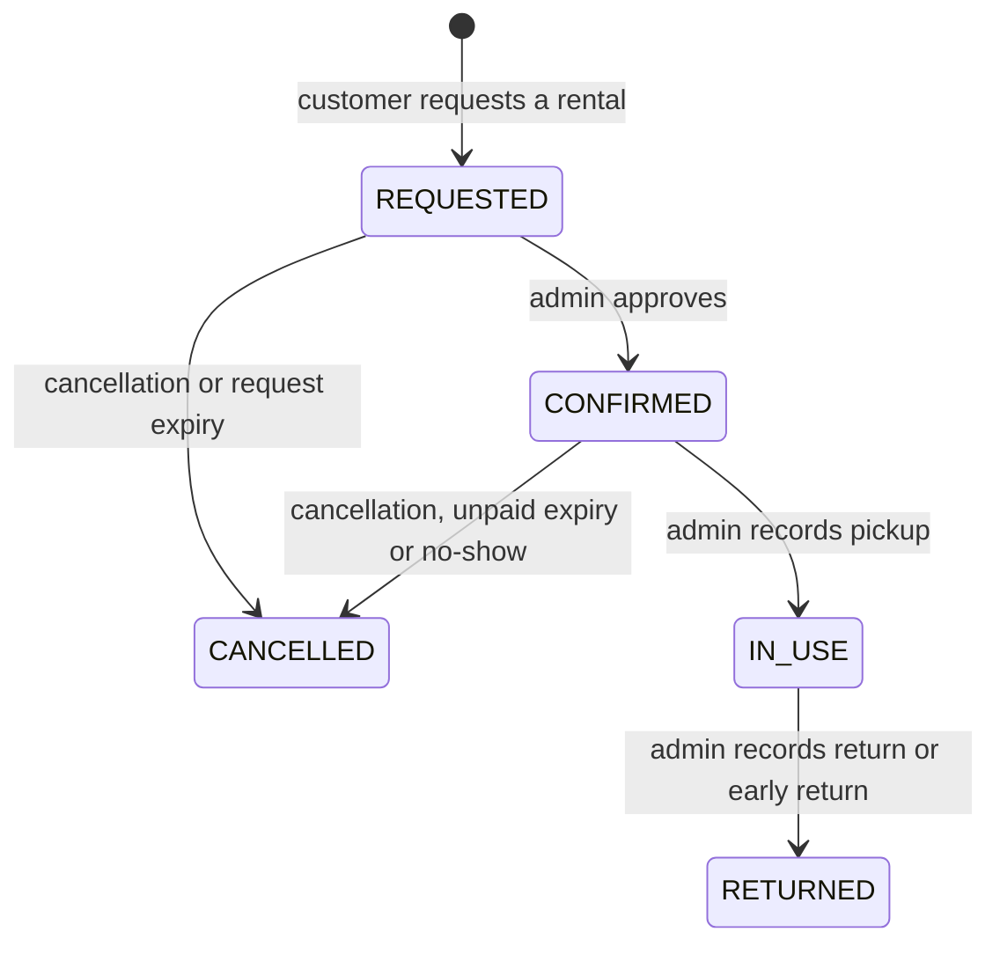
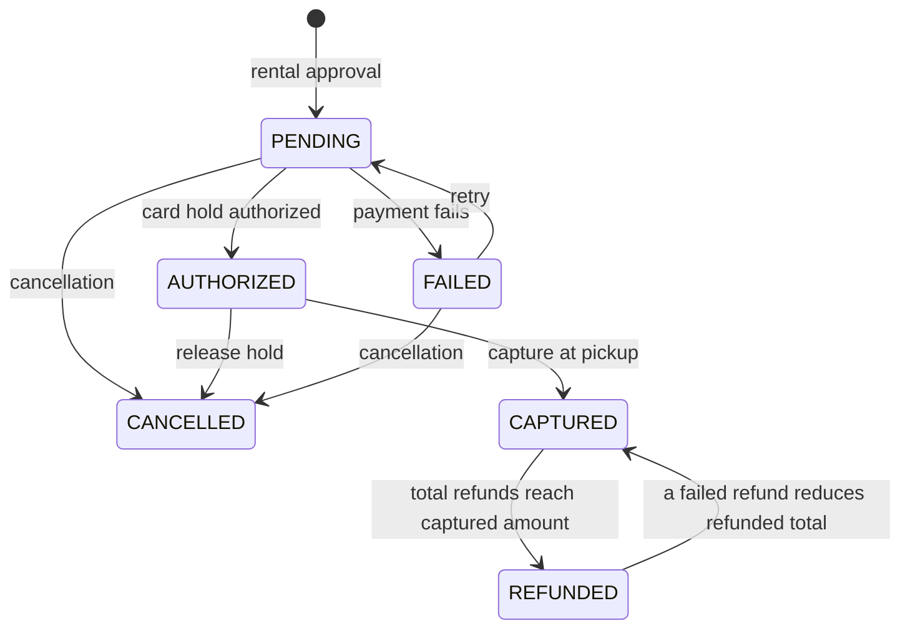
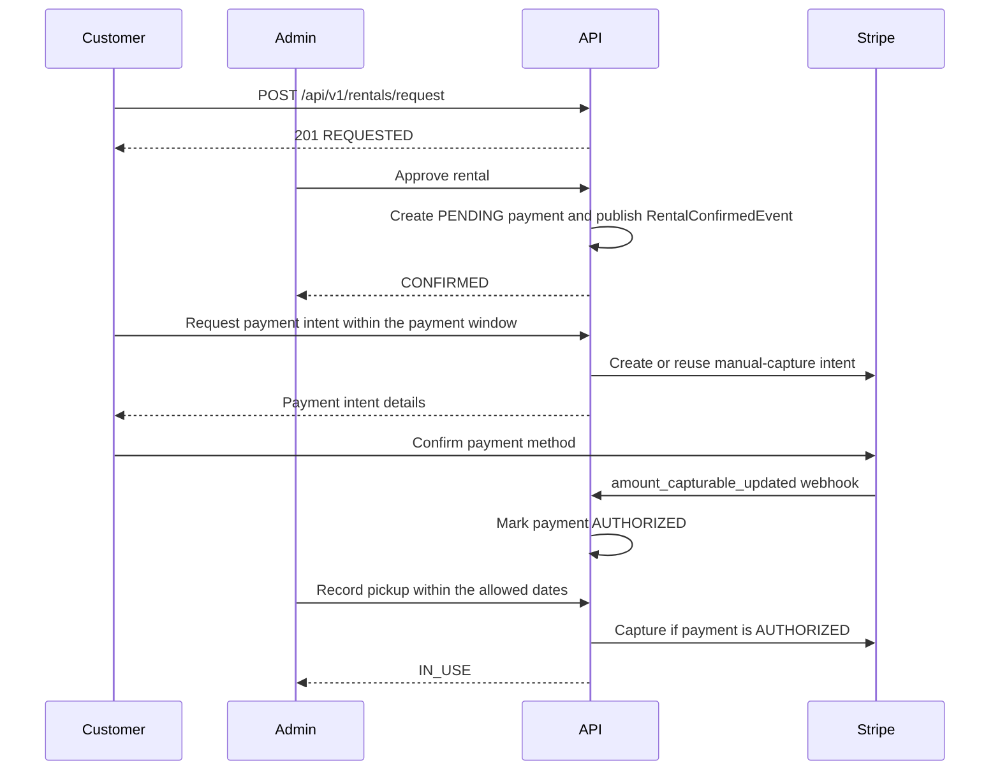
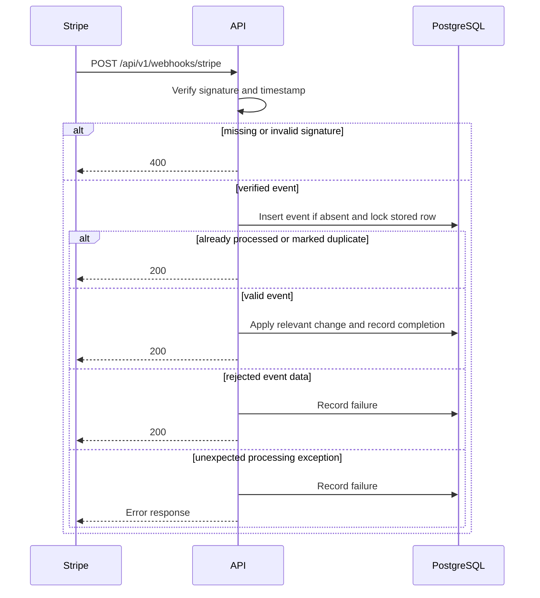

# Architecture diagrams

These flows describe the API's local portfolio scope. The Stripe integration uses test mode and the development and test profiles use a stub gateway. [Developer guide](DEVELOPER_GUIDE.md) · [Payment design](adr/ADR-011-stripe-manual-capture-payment-intents.md)

## Rental lifecycle

An unpaid approval becomes eligible for expiry at the later of midnight UTC at the start of the start date and approval time plus the grace period. The job checks pending or failed payment attempts before cancelling. An authorized rental can be released by the no-show sweep. [Payment deadline](adr/ADR-014-payment-deadline-after-approval.md)

Pickup requires a confirmed rental and an authorized or captured payment. The date must be on or after the start date and on or before both the end date and the last day before the no-show cutoff. Pickup is refused while another rental has the same car in use. [Rental lifecycle service](../../src/main/java/com/akif/rental/internal/service/RentalLifecycleService.java)

An early return compares the used-period price with the full-period price under current pricing, scales the result to the original rental total and refunds the eligible difference. The service uses a prorated amount if repricing is unavailable under the conditions described in the [pricing decision](adr/ADR-006-dynamic-pricing-strategy.md).

## Payment states

The diagram shows the normal rental payment path, retry, cancellation and refund. Provider events can also reconcile a payment that missed an earlier update. [Payment entity](../../src/main/java/com/akif/payment/domain/Payment.java) · [Payment state service](../../src/main/java/com/akif/payment/internal/service/PaymentStateService.java)

## Rental payment and pickup

The notification module handles `RentalConfirmedEvent`. A captured payment can be partially refunded and keep its `CAPTURED` status. A full refund moves it to `REFUNDED`. [E-mail listener](../../src/main/java/com/akif/notification/internal/listener/EmailEventListener.java) · [Refund service](../../src/main/java/com/akif/payment/internal/service/PaymentRefundService.java)

## Stripe webhook processing

The handler records validation failures and acknowledges them. Unexpected processing failures reach the HTTP error path, allowing redelivery. A redelivered failed event can be processed again under the event lock. [Webhook handler](../../src/main/java/com/akif/payment/internal/webhook/StripeWebhookHandler.java) · [Webhook security](../security/AUTHENTICATION.md#stripe-webhook-security)
