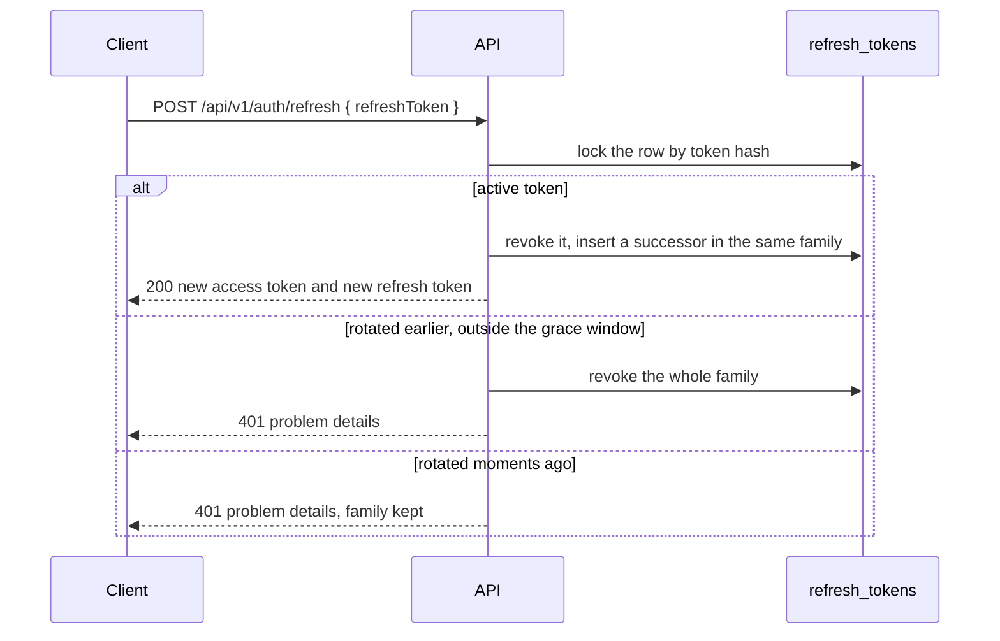
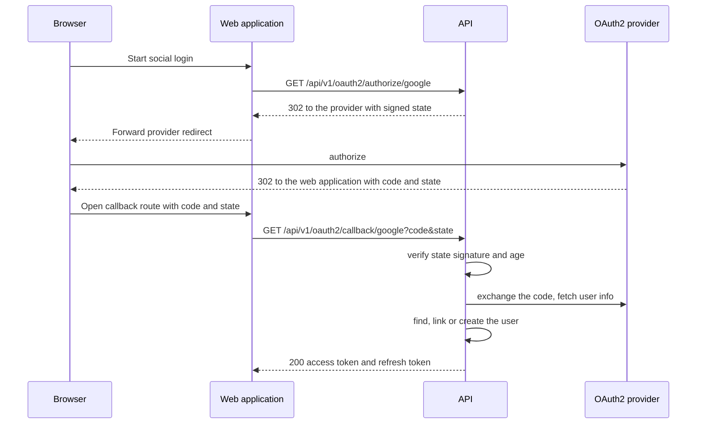

# Authentication and authorization

How the Car Rental API authenticates callers, issues and revokes tokens, authorizes requests and verifies Stripe webhooks.

## Overview

| Mechanism | Purpose | Implementation |
|-----------|---------|----------------|
| Access token | Stateless API authentication | JWT signed with HS256, validated by the Spring Security OAuth2 resource server |
| Refresh token | Session renewal | Opaque random value, stored only as a SHA-256 hash, rotated on every use |
| Social login | Sign in with Google or GitHub | OAuth2 authorization-code flow with an HMAC-signed `state` |
| Role-based access | Authorization | Roles `USER` and `ADMIN`, path rules in `ApiAccessPolicy` |

## Access token

The API signs and verifies its own tokens with one symmetric key (`jwt.secret`, at least 32 bytes), so no key distribution is needed. The resource server validates signature, expiry (against the application `Clock`, with no leeway), issuer and the `token_use` claim.

| Claim | Meaning |
|-------|---------|
| `iss` | `car-rental-api` (`jwt.issuer`) |
| `sub` | Username |
| `iat`, `exp` | Issued at and expiry; the lifetime is `JWT_ACCESS_TOKEN_EXPIRATION` (default 900000 ms) |
| `token_use` | `access`. A JWT without this value is rejected as a bearer token |
| `userId` | Database id of the user |
| `roles` | Role names without the `ROLE_` prefix |

There is no custom JWT filter: Spring Security's bearer-token filter decodes the token and `JwtUserAuthenticationConverter` maps `roles` to `ROLE_*` authorities. The principal is an `AuthenticatedUser` with the signed `userId` claim. [JWT converter](../../src/main/java/com/akif/shared/security/JwtUserAuthenticationConverter.java) · [ADR-009](../architecture/adr/ADR-009-resource-server-and-rotating-refresh-tokens.md) `/api/v1/auth/**` and `/api/v1/webhooks/**` ignore any `Authorization` header.

Access JWTs have no revocation list. Banning a user or changing a password revokes refresh tokens. Existing access JWTs may still pass bearer authentication until expiry, which defaults to 15 minutes.

## Refresh token

A refresh token is 32 random bytes, Base64url encoded. `RefreshTokenService` stores only its SHA-256 hash in `refresh_tokens` (migration `V3`), together with a family id. A refresh token is never a valid bearer token.

- **Rotation.** Every successful `POST /api/v1/auth/refresh` revokes the presented token and issues a successor in the same family. The response carries a new access token and a new refresh token; `expiresIn` is the access token lifetime in seconds.
- **Reuse detection.** Presenting an already-rotated token revokes every active token of its family and answers 401, unless it was rotated within `jwt.refresh-reuse-grace-seconds` (default 10). Inside that window only the request is rejected and the family stays alive, which protects the session when two refreshes race.
- **Expiry.** `JWT_REFRESH_TOKEN_EXPIRATION` (default seven days). An expired token answers 401 `TOKEN_EXPIRED`. A nightly job deletes tokens that expired more than seven days ago.
- **Revocation.** `POST /api/v1/auth/logout` revokes the token's family. A password change, a password reset and a ban revoke every refresh token of the user.
- **Account state.** Password login, the OAuth2 callback, account linking and refresh all refuse a user who is disabled, banned or deleted.

Tests: `RefreshTokenIntegrationTest`, `JwtTokenServiceTest`, `BearerAuthenticationIntegrationTest`.

## Passwords

Passwords are hashed with BCrypt (`BCryptPasswordEncoder`, default strength). Registration requires a password of at least 8 characters. New local accounts are created unverified (`users.email_verified = false`).

## OAuth2 social login

| Provider | Authorization endpoint | Scopes |
|----------|------------------------|--------|
| Google | `GET /api/v1/oauth2/authorize/google` | `openid`, `email`, `profile` |
| GitHub | `GET /api/v1/oauth2/authorize/github` | `user:email`, `read:user` |

The API returns a 302 redirect from its authorize endpoint. The configured provider redirect URI is a route of the web application. In the integration flow below the web server forwards the redirect and submits `code` and `state` to `GET /api/v1/oauth2/callback/{provider}`. The API returns the same token body as password login. [OAuth configuration](../../src/main/resources/application-prod.properties)

**State.** The `state` value is `Base64Url(timestamp.random.signature)`: an epoch-seconds timestamp, 16 random bytes and an HMAC-SHA256 signature made with `OAUTH2_STATE_SECRET`. Validation checks the format, compares the signature in constant time and rejects a value older than `oauth2.state.expiration-minutes` (default 10). The state is stateless on the server; it is not bound to the browser that started the flow.

**Account rules.**

- Google must report the e-mail as verified.
- An OAuth2 sign-in with an e-mail that matches an existing local account links automatically only when that account's e-mail is verified; otherwise the API answers 409 `OAUTH2_LOCAL_ACCOUNT_UNVERIFIED`, and the user signs in with the password and links the provider with `POST /api/v1/oauth2/link/{provider}`.
- Accounts created through OAuth2 are marked verified.
- Linking requires an authenticated user, and a social account that is already linked to another user answers 409 `OAUTH2_ACCOUNT_ALREADY_LINKED`.

## Authorization

`ApiAccessPolicy` is the single source of the path and role rules. `SecurityConfig` enforces them, `openapi/endpoint-inventory.txt` lists the resulting access level of every operation, and `EndpointInventoryTest` asserts that the security chain enforces the inventory. A request that matches no rule requires authentication.

| Level | Meaning | Examples |
|-------|---------|----------|
| `PUBLIC` | No token | Auth endpoints, OAuth2 authorize and callback, car browsing and availability search, exchange rates, pricing preview and strategies, the Stripe webhook |
| `AUTHENTICATED` | Any valid token | Rental detail, cancel and payment status, pricing calculation, profile, avatar and password change, OAuth2 account linking, own damages, local files subject to ownership |
| `USER` | Role `USER` | `POST /api/v1/rentals/request`, `GET /api/v1/rentals/me`, `POST /api/v1/rentals/{id}/payment-intent` |
| `ADMIN` | Role `ADMIN` | Rental confirm, pickup, return and early return, car writes, everything under `/api/v1/admin/**`, exchange-rate refresh |

Ownership checks apply in addition to path rules. Reading or cancelling another customer's rental returns 404. Local file downloads require an authenticated owner or admin and return 404 when the file is missing or outside the caller's access. [Rental query](../../src/main/java/com/akif/rental/internal/service/RentalQueryService.java) · [Endpoint inventory](../../openapi/endpoint-inventory.txt)

Failures use the problem-details format: a missing or invalid token answers 401 `AUTHENTICATION_FAILED` through `JsonAuthenticationEntryPoint`, and an insufficient role answers 403 `ACCESS_DENIED` through `JsonAccessDeniedHandler`.

Swagger UI and `/v3/api-docs` exist outside `prod` only. Actuator health, info and Prometheus are served on the management port by a separate security chain. Other management paths can return 401 or 404.

## Stripe webhook security

`POST /api/v1/webhooks/stripe` is public but authenticated by signature.

- **Signature.** `Webhook.constructEvent` verifies the `Stripe-Signature` header with `STRIPE_WEBHOOK_SECRET`, using the application `Clock` and a tolerance of `stripe.webhook.tolerance-seconds` (300). A missing header answers 400 `WEBHOOK_SIGNATURE_MISSING`, a bad one 400 `WEBHOOK_SIGNATURE_INVALID`.
- **Size.** Bodies above `stripe.webhook.max-body-bytes` (256 KB) answer 413.
- **Replay.** Each Stripe event id is stored once (`webhook_events`, unique). The row is locked while the event is processed, and an event already `PROCESSED` or `DUPLICATE` is skipped. A `FAILED` event is processed again when Stripe redelivers it.
- **Scope.** PaymentIntent events must match the configured environment and any installation tag. Lookup uses the stored PaymentIntent ID first. Fallback by payment metadata requires the current installation tag, an unlinked payment and a non-cancellation event. The authorization and success handlers require matching amounts and currency. A validation rejection is recorded and acknowledged with 200. An unexpected processing exception is recorded and propagated. [Webhook handler](../../src/main/java/com/akif/payment/internal/webhook/StripeWebhookHandler.java)

| Event | Effect |
|-------|--------|
| `payment_intent.amount_capturable_updated` | The payment becomes `AUTHORIZED` |
| `payment_intent.succeeded` | The payment becomes `CAPTURED` |
| `payment_intent.payment_failed` | A `PENDING` payment becomes `FAILED`; an authorized payment is not downgraded |
| `payment_intent.canceled` | The remote cancellation is applied |
| `charge.refunded` | Refunds are applied to the stored total |
| `refund.updated`, `refund.failed` | The refunded total is adjusted |

Other event types are acknowledged and ignored. Tests: `StripeWebhookSignedIntegrationTest`.
